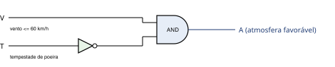
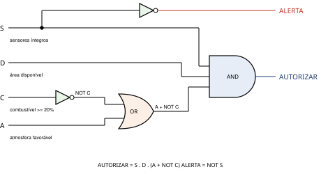
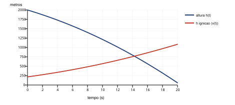
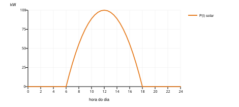

# MGPEB – Módulo de Gerenciamento de Pouso e Estabilização de Base

**Atividade Integradora – Fase 2 · Missão Aurora Siger**

O MGPEB é o sistema responsável por organizar o pouso dos módulos da colônia Aurora Siger em Marte. Ele mantém a fila de módulos que chegam à órbita, decide com base em regras lógicas se cada pouso é **autorizado**, **adiado** ou colocado em **alerta**, e usa modelos matemáticos para definir o momento de acionar os retrofoguetes e os melhores horários de operação da base.

> 📄 **Relatório técnico completo (PDF):** [Relatorio_Tecnico_MGPEB.pdf](Relatorio_Tecnico_MGPEB.pdf)
>
> 🐍 **Código-fonte do protótipo:** [mgpeb.py](mgpeb.py)

---

## Sumário

1. [Entregáveis](#1-entregáveis)
2. [Como executar](#2-como-executar)
3. [Cenário de pouso e módulos](#3-cenário-de-pouso-e-módulos)
4. [Regras de decisão e portas lógicas](#4-regras-de-decisão-e-portas-lógicas)
5. [Protótipo em Python](#5-protótipo-em-python)
6. [Modelagem matemática](#6-modelagem-matemática)
7. [Evolução da computação](#7-evolução-da-computação)
8. [ESG e governança](#8-esg-e-governança)
9. [Anexo – Estruturas de dados](#9-anexo--estruturas-de-dados)

---

## 1. Entregáveis

| Entregável | Arquivo | Conteúdo |
|---|---|---|
| Relatório técnico (PDF, 9 páginas) | [`Relatorio_Tecnico_MGPEB.pdf`](Relatorio_Tecnico_MGPEB.pdf) | Cenário, módulos, diagramas de portas lógicas, tabela-verdade, modelagem matemática com gráficos, contexto histórico, ESG e Anexo A |
| Código-fonte em Python | [`mgpeb.py`](mgpeb.py) | Protótipo comentado e executável |
| Anexo de estruturas de dados | Anexo A do PDF + [seção 9](#9-anexo--estruturas-de-dados) deste README | Uso de listas, fila e pilha com exemplos |
| Figuras | [`imagens/`](imagens) | Diagramas de portas lógicas e gráficos usados no relatório |

## 2. Como executar

Requer apenas **Python 3**. Nenhuma biblioteca externa é necessária.

```bash
python mgpeb.py
```

O programa executa, em sequência: cadastro dos módulos, buscas, ordenações, simulação de duas janelas de pouso, exibição das listas finais, leitura da pilha de histórico e as tabelas da modelagem matemática.

## 3. Cenário de pouso e módulos

A base conta com **3 plataformas de pouso por janela de operação**. Sete módulos chegam à órbita:

| Código | Tipo | Prioridade | Combustível | Massa | Criticidade | Chegada | Sensores |
|---|---|:-:|:-:|:-:|:-:|:-:|:-:|
| HAB-01 | Habitação | 5 | 55% | 12.000 kg | alta | 30 min | OK |
| ENE-02 | Energia | 5 | 40% | 8.500 kg | alta | 10 min | OK |
| LAB-03 | Laboratório | 3 | 70% | 6.000 kg | média | 50 min | OK |
| LOG-04 | Logística | 2 | 15% | 9.500 kg | baixa | 20 min | OK |
| MED-05 | Suporte Médico | 4 | 35% | 4.000 kg | alta | 40 min | OK |
| COM-06 | Comunicação | 3 | 60% | 3.000 kg | média | 60 min | **FALHA** |
| AGR-07 | Agricultura | 2 | 8% | 7.000 kg | média | 70 min | OK |

- **Prioridade:** 1 (baixa) a 5 (altíssima).
- **Critério da fila:** maior prioridade primeiro; em caso de empate, menor combustível primeiro, porque quem tem menos combustível pode esperar menos em órbita.

## 4. Regras de decisão e portas lógicas

| Variável | Significado | Verdadeira (1) quando |
|:-:|---|---|
| **C** | Combustível suficiente | combustível ≥ 20% |
| **A** | Atmosfera favorável | vento ≤ 60 km/h **E** sem tempestade de poeira |
| **D** | Área de pouso disponível | existe plataforma livre |
| **S** | Sensores íntegros | autodiagnóstico sem falhas |

### Expressões booleanas

```
A         = V AND (NOT T)                      V = vento dentro do limite, T = tempestade
AUTORIZAR = S AND D AND (A OR (NOT C))
ALERTA    = NOT S
ESPERA    = S AND NOT( D AND (A OR (NOT C)) )
```

**Leitura:** com sensores bons e plataforma livre, o módulo pousa se a atmosfera estiver boa **ou** se o combustível estiver abaixo do mínimo. Nesse segundo caso é um pouso de emergência, porque continuar em órbita seria mais perigoso. Com falha de sensores, o pouso é bloqueado e o módulo vai para alerta.

### Circuito da condição atmosférica (A)



### Circuito da decisão de pouso



### Tabela-verdade (casos com S = 1)

| S | D | A | C | A + ¬C | AUTORIZAR | ALERTA | ESPERA |
|:-:|:-:|:-:|:-:|:-:|:-:|:-:|:-:|
| 1 | 0 | 0 | 0 | 1 | 0 | 0 | 1 |
| 1 | 0 | 0 | 1 | 0 | 0 | 0 | 1 |
| 1 | 0 | 1 | 0 | 1 | 0 | 0 | 1 |
| 1 | 0 | 1 | 1 | 1 | 0 | 0 | 1 |
| 1 | 1 | 0 | 0 | 1 | **1** | 0 | 0 |
| 1 | 1 | 0 | 1 | 0 | 0 | 0 | 1 |
| 1 | 1 | 1 | 0 | 1 | **1** | 0 | 0 |
| 1 | 1 | 1 | 1 | 1 | **1** | 0 | 0 |

Com S = 0, a saída é sempre **ALERTA**. A tabela completa, com as 16 combinações, está no PDF.

## 5. Protótipo em Python

### Algoritmos utilizados

| Algoritmo | Função no código | Uso no MGPEB | Complexidade |
|---|---|---|:-:|
| Busca linear | `buscar_menor_combustivel()` | módulo com menos combustível | O(n) |
| Busca linear | `buscar_maior_prioridade()` | módulo de maior prioridade | O(n) |
| Busca linear | `buscar_por_tipo()` | módulos de um tipo de carga | O(n) |
| Busca binária | `busca_binaria_por_chegada()` | módulo por horário de chegada | O(log n) |
| Selection sort | `selection_sort_por_chegada()` | ordenar por horário de chegada | O(n²) |
| Insertion sort | `insertion_sort_fila()` | reorganizar a fila de pouso | O(n²) |

### Função booleana traduzida em IF / ELIF / ELSE

```python
def decidir_pouso(modulo, clima, plataformas_livres):
    C = modulo["combustivel"] >= COMBUSTIVEL_MINIMO
    A = atmosfera_favoravel(clima)
    D = plataformas_livres > 0
    S = modulo["sensores_ok"]

    if not S:
        return "ALERTA"                      # NOT S
    elif D and (A or not C):
        return "AUTORIZADO"                  # S AND D AND (A OR NOT C)
    else:
        return "ESPERA"                      # S AND NOT(D AND (A OR NOT C))
```

### Exemplo de saída

```
--- JANELA DE POUSO 1 | vento 35 km/h | tempestade: nao | plataformas: 3 ---
  ENE-02  Energia         -> AUTORIZADO (condicoes normais)
  HAB-01  Habitacao       -> AUTORIZADO (condicoes normais)
  MED-05  Suporte Medico  -> AUTORIZADO (condicoes normais)
  COM-06  Comunicacao     -> ALERTA     (falha de sensores)
  LAB-03  Laboratorio     -> ESPERA     (sem plataforma livre)
  AGR-07  Agricultura     -> ESPERA     (sem plataforma livre)
  LOG-04  Logistica       -> ESPERA     (sem plataforma livre)

--- JANELA DE POUSO 2 | vento 85 km/h | tempestade: sim | plataformas: 3 ---
  LAB-03  Laboratorio     -> ESPERA     (atmosfera desfavoravel)
  AGR-07  Agricultura     -> AUTORIZADO (pouso de EMERGENCIA (combustivel critico))
  LOG-04  Logistica       -> AUTORIZADO (pouso de EMERGENCIA (combustivel critico))
```

Na janela 2 há tempestade (A = 0). O Laboratório, com 70% de combustível, continua esperando, enquanto Agricultura (8%) e Logística (15%) recebem pouso de emergência, porque ¬C = 1.

## 6. Modelagem matemática

### 6.1 Altura e velocidade na descida (funções quadrática e linear)

```
h(t) = h0 - v0·t - (g/2)·t²        h0 = 2000 m, v0 = 60 m/s, g = 3,71 m/s² (Marte)
v(t) = v0 + g·t
```

A altura é uma parábola com concavidade para baixo: o módulo cai cada vez mais rápido, porque a velocidade cresce de forma linear.

### 6.2 Momento de acionar os retrofoguetes

```
h_ign(v) = v² / (2·(a_motor - g))   a_motor = 12 m/s²
```

`h_ign` é a altura mínima para conseguir zerar a velocidade. Ela **sobe** com o tempo, enquanto `h(t)` **desce**. O cruzamento das curvas é o último instante seguro. Com margem de 20%, o MGPEB aciona os retrofoguetes em **t = 14 s, a cerca de 796 m de altura**.



### 6.3 Energia solar ao longo do dia (função quadrática)

```
P(t) = Pmax · (1 - ((t - 12) / 6)²),  para 6h ≤ t ≤ 18h   (Pmax = 100 kW)
```



### 6.4 Relação com as decisões de engenharia

- `h(t)` e `h_ign` definem **quando acionar os retrofoguetes**: acionar cedo demais gasta combustível; tarde demais, o módulo bate no solo.
- Módulos com pouco combustível têm menor margem de manobra, por isso **¬C** funciona como gatilho de emergência na regra lógica.
- A potência fica acima de 75 kW apenas entre **9h e 15h**. As janelas de pouso ficam nesse intervalo, com **no máximo 3 pousos por janela**.

## 7. Evolução da computação

| Marco | Relação com o MGPEB |
|---|---|
| **ENIAC (1946)**: cerca de 18 mil válvulas, 27 t, 150 kW | Primeiro computador eletrônico de propósito geral |
| **Arquitetura de von Neumann (1945)** | Programa armazenado na memória: é a base de qualquer sistema embarcado |
| **Transistor (1947) e circuito integrado (1958–59)** | Redução de tamanho, peso e consumo, o que tornou viáveis os computadores de bordo |
| **Apollo Guidance Computer** | Cerca de 4 KB de RAM. No pouso da Apollo 11, descartou tarefas de baixa prioridade para manter as críticas, a mesma ideia de fila por prioridade usada no MGPEB |
| **RAD750 (Curiosity / Perseverance)** | Processador resistente à radiação, até 200 MHz e 256 MB de RAM |

**Limitações em Marte e como influenciaram o projeto:**

- **Pouca memória:** listas, fila e pilha simples, com ordenação feita na própria lista.
- **Processamento limitado:** algoritmos simples e previsíveis. Com poucos módulos, O(n²) é aceitável.
- **Energia limitada:** poucos cálculos por decisão e janelas de pouso no pico solar.
- **Radiação:** regras booleanas curtas, fáceis de verificar e replicar, por exemplo com votação por maioria `A·B + A·C + B·C`.
- **Atraso de 4 a 24 min até a Terra:** as decisões são tomadas no próprio local, sem esperar comandos.
- Python puro, sem bibliotecas pesadas e sem recursão.

## 8. ESG e governança

**Ambiental**
- Área de pouso plana e estável, próxima de gelo subterrâneo, mas **fora de regiões de interesse científico** e afastada de sítios históricos, como pousos de sondas anteriores.
- Plataformas concentradas em uma única zona, para reduzir poeira e contaminação.
- Energia solar com baterias e uma fonte de reserva. Cargas não essenciais são desligadas por prioridade.
- Água reciclada em circuito fechado, resíduos orgânicos transformados em adubo, regolito usado em construção e oxigênio produzido a partir do CO₂ local (tecnologia testada pelo experimento MOXIE).

**Social**
- Segurança e saúde em primeiro lugar: Habitação, Energia e Suporte Médico têm prioridade máxima.
- Acesso igual a ar, água, energia e atendimento médico, rodízio de tarefas de risco e cuidado com a saúde mental.

**Governança**
- **Transparência:** toda decisão fica registrada no histórico, aberto para auditoria.
- **Supervisão humana:** um responsável de turno pode intervir, e a intervenção também é registrada.
- **Participação:** um conselho da colônia aprova os limites usados pelo sistema (combustível mínimo, vento máximo).
- **Ética e legalidade:** segue o Tratado do Espaço Exterior (1967), que exige uso pacífico do espaço e proíbe apropriação nacional.
- **Regras legíveis:** qualquer pessoa da tripulação consegue entender por que um pouso foi autorizado ou adiado.

## 9. Anexo – Estruturas de dados

| Estrutura | Variável | Operações | Uso |
|---|---|---|---|
| Lista | `cadastrar_modulos()` | `append`, percorrer | cadastro inicial dos módulos |
| **Fila (FIFO)** | `fila_pouso` | `append` / `pop(0)` | módulos aguardando autorização |
| Lista | `pousados` | `append` | módulos que já pousaram |
| Lista | `em_espera` | `append` / `pop(0)` | adiados; voltam à fila na janela seguinte |
| Lista | `em_alerta` | `append` | módulos com falha de sensores |
| **Pilha (LIFO)** | `historico` | `append` / `pop()` | registro das decisões, a mais recente no topo |

**Fila:** o primeiro a entrar é o primeiro a sair.

```
fila_pouso = [ENE-02, HAB-01, MED-05, COM-06, LAB-03, AGR-07, LOG-04]
desenfileirar(fila_pouso)  ->  ENE-02
```

**Listas auxiliares** após a janela 1:

```
pousados  = [ENE-02, HAB-01, MED-05]
em_alerta = [COM-06]
em_espera = [LAB-03, AGR-07, LOG-04]   ->  voltam para fila_pouso na janela 2
```

**Pilha:** o último evento registrado é o primeiro a ser lido.

```
desempilhar(historico)  ->  "Janela 2: LOG-04 -> AUTORIZADO"
desempilhar(historico)  ->  "Janela 2: AGR-07 -> AUTORIZADO"
desempilhar(historico)  ->  "Janela 2: LAB-03 -> ESPERA"
```

---

## Estrutura do repositório

```
MGPEB/
├── README.md                     # este arquivo
├── mgpeb.py                      # protótipo em Python
├── Relatorio_Tecnico_MGPEB.pdf   # relatório técnico (PDF)
└── imagens/                      # diagramas e gráficos
    ├── portas_logicas_atmosfera.svg
    ├── portas_logicas_decisao.svg
    ├── grafico_descida.svg
    └── grafico_energia_solar.svg
```
